  <picture>
    <source media="(prefers-color-scheme: dark)" srcset="./assets/dark.svg">
    <source media="(prefers-color-scheme: light)" srcset="./assets/light.svg">
    
  </picture>

 

  
  
  

## About me

A software development student at, interested in the intersection of **software development, data analysis and digital design**. I enjoy turning visual ideas into clear, useful and engaging digital experiences.

My current learning path combines frontend development with interface design, while I continue strengthening my foundations in software development and data-oriented problem solving.

## Technologies & tools

**Development**

  
  
  
  
  
  
  

**Design & workflow**

  
  
  
  
  

## Selected projects

<table>
  <tr>
    <td width="50%" valign="top">
      <h3><a href="https://github.com/chrisbentz121/Designfitzoneai">Designfitzoneai</a></h3>
      
A Figma-based SaaS design-system landing page implemented as a frontend project. A snapshot of my interest in translating interface concepts into web experiences.

      
React · Vite · Tailwind CSS · UI components

      <a href="https://github.com/chrisbentz121/Designfitzoneai">Explore repository →</a>
    </td>
    <td width="50%" valign="top">
      <h3><a href="https://github.com/chrisbentz121/Proyecto3-fundamentos-CSS">CSS Foundations</a></h3>
      
A collection of CSS practice exercises and a final challenge, organized as part of my ongoing frontend learning process.

      
HTML · CSS · Layout fundamentals

      <a href="https://github.com/chrisbentz121/Proyecto3-fundamentos-CSS">Explore repository →</a>
    </td>
  </tr>
</table>

## GitHub overview

  
  

---

  Building with curiosity. Designing with intention. Learning every day.

